<a href="https://www.mikelarnao.com/"><picture><source media="(prefers-color-scheme: dark)" srcset="./cards/hero-dark.svg"></picture></a>

<a href="https://www.mikelarnao.com/works/seat-ateca/"><picture><source media="(prefers-color-scheme: dark)" srcset="./cards/tile-1-dark.svg"></picture></a>
<a href="https://www.mikelarnao.com/works/cycle-dry/"><picture><source media="(prefers-color-scheme: dark)" srcset="./cards/tile-2-dark.svg"></picture></a>
<a href="https://www.mikelarnao.com/works/ardura/"><picture><source media="(prefers-color-scheme: dark)" srcset="./cards/tile-3-dark.svg"></picture></a>

<picture><source media="(prefers-color-scheme: dark)" srcset="./cards/tools-dark.svg"></picture>

<picture><source media="(prefers-color-scheme: dark)" srcset="https://skillicons.dev/icons?i=react%2Cnextjs%2Cts%2Ctailwind%2Cthreejs%2Cblender&theme=dark"></picture>

<!-- Activity card: rendered every day into cards/activity-*.svg, left out until there are a few months of data.
<picture><source media="(prefers-color-scheme: dark)" srcset="./cards/activity-dark.svg"></picture>
-->

[mikelarnao.com](https://www.mikelarnao.com/) · [All works](https://www.mikelarnao.com/works/) · [LinkedIn](https://www.linkedin.com/in/mikelarnao) · [Email](mailto:arnaoazpiazu@gmail.com)

<!--
How this page is made: every card is an SVG drawn by scripts/render.mjs from the portfolio's published content and
this account's contributions; .github/workflows/cards.yml redraws them every morning. No dependencies:
  node scripts/render.mjs            (STATIC=1 for the final frame, without animations)
If a pinned project changes on the site, update the three tile links above (the script prints their ids).
-->
